<p align="center">
  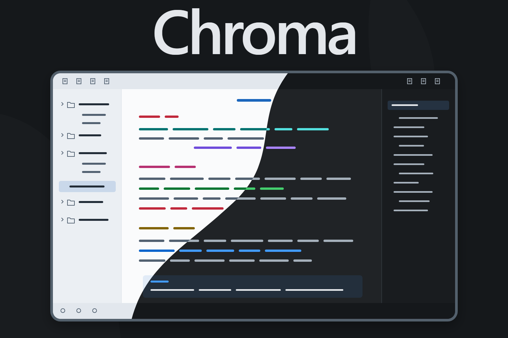
</p>

# Chroma for Obsidian

Neutral backgrounds. Color where it counts.

Chroma gives your notes a quiet background and uses color to distinguish links, tasks, callouts, and tables. Start with **Neutral**, the default color scheme, or choose a different palette without changing the layout.

[Previews](#previews) · [Features](#features) · [Install](#install) · [Customize](#customize) · [Report an issue](https://github.com/EdenEast/obsidian-chroma/issues)

## Previews

### Neutral dark

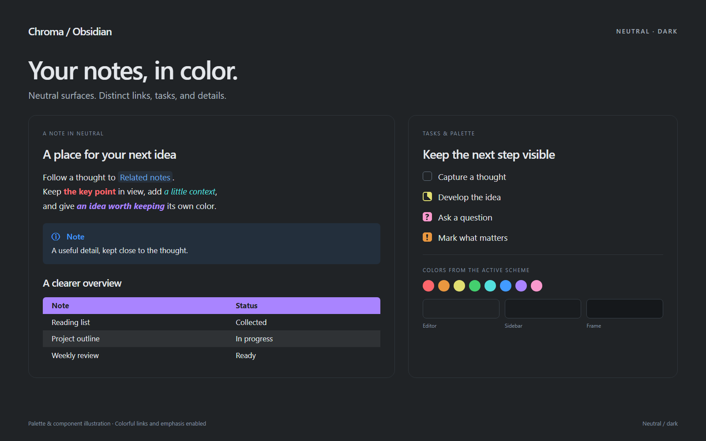

### Neutral light

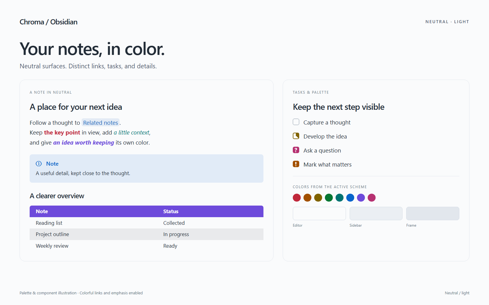

These are palette and component illustrations rendered with Chroma's CSS, rather than screenshots of Obsidian. Both show Neutral with **Colorful links and emphasis** enabled through Style Settings.

## Features

Chroma brings color to the parts of a note that help you find your place:

- **Light and dark appearances.** Every Chroma color scheme includes both modes.
- **A choice of desktop layouts.** Keep the default panels, or choose Cards, Soft shadows, Three levels, or Raised editor.
- **Callouts with different treatments.** Choose Filled, Outlined, Accent line, Tinted with accent line, Tinted, or Solid.
- **Colorful links and emphasis.** Give internal links a soft pill background and use distinct colors for bold, italic, and bold italic text.
- **More expressive tasks.** Alternate checkbox markers give tasks such as in progress, question, and important their own appearance.
- **Tables that are easier to scan.** Filled headers and striped rows extend to Bases tables. Bases lists and Dataview lists also get striped rows.
- **Optional color for folders and headings.** Keep both plain, or add color from the active palette.

## Color schemes

Chroma includes **Neutral**, Harbor, Parchment, Forest, Carbon, Mulberry, and Crimson. Each has a light and a dark appearance. Neutral is the default, including when Style Settings is absent.

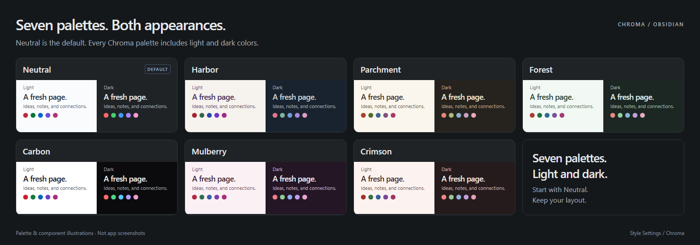

Palette illustrations. Neutral remains the starting point, and the appearance options work across Chroma's palettes.

Additional palettes adapt colors from other themes. They keep Chroma's layout and component styles:

- **Dark:** Dracula, Tokyo Night, Gruvbox Dark, Horizon, Sonokai Espresso, Nordic, Coffee, Nightfox, Mocha Dark, Panda Syntax, and Everforest.
- **Light:** Gruvbox Light, Dayfox, Panda Syntax, and Everforest.

The dark and light overrides are independent. For example, you can use Neutral in light mode and Nightfox in dark mode.

## Install

Chroma requires **Obsidian 1.10.6 or later**. The theme works without plugins.

1. Download this repository with **Code → Download ZIP**.
2. Extract the ZIP file.
3. Open your vault's `.obsidian/themes/` folder. Create the `themes` folder if it does not exist.
4. Create a folder named `Chroma` inside `themes`.
5. Copy `theme.css` and `manifest.json` into `Chroma`.
6. In Obsidian, open **Settings → Appearance**.
7. Select **Chroma** from the theme selector.

The `Chroma` folder name must match the theme name in `manifest.json`. The README, documentation, and images are not required to run the theme.

To choose light or dark mode, change **Base color scheme** in **Settings → Appearance**.

### Update or remove the theme

To update a local installation, replace `theme.css` and `manifest.json` with the current files from this repository. If the appearance does not refresh, restart Obsidian.

To return to Obsidian's default theme, select the default theme in **Settings → Appearance**.

## Customize

The optional [Style Settings plugin](https://github.com/community-archive/obsidian-style-settings) adds Chroma's appearance controls.

1. Open **Settings → Community plugins**.
2. If restricted mode is on, turn it off.
3. Select **Browse**.
4. Search for **Style Settings**.
5. Install the plugin.
6. Enable the plugin.
7. Open **Settings → Style Settings → Chroma**.

### Choose a color scheme

**Color scheme** defaults to **Neutral**. Choose Neutral, Harbor, Parchment, Forest, Carbon, Mulberry, or Crimson for both appearances.

**Dark mode scheme** and **Light mode scheme** default to **None**. Each offers the [additional palettes listed above](#color-schemes) for that mode. An override replaces the Chroma palette only in its corresponding mode. **None** uses **Color scheme**.

For example, **Color scheme: Neutral**, **Dark mode scheme: Nightfox**, and **Light mode scheme: None** give you Nightfox in dark mode and Neutral in light mode.

### Change the interface

#### Panel style

**Panel style** defaults to **Default** and applies on desktop only:

- **Default:** The theme's standard panel separation.
- **Cards:** Rounded panels on a darker frame, with floating tabs.
- **Soft shadows:** Shadows between the sidebars and editor.
- **Three levels:** Different background levels for the ribbon, tab bars, sidebars, and editor.
- **Raised editor:** A rounded editor with a shadow and darker surroundings.

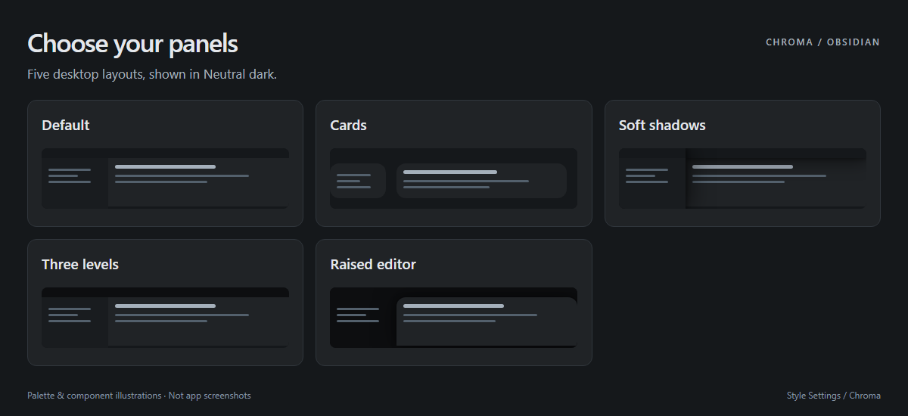

#### Folder colors

**Folder colors** defaults to **Plain**. **Colored text** colors folder names. **Colored blocks** fills each top-level folder. Nested folders inherit their top-level folder's color, and colors follow folder position.

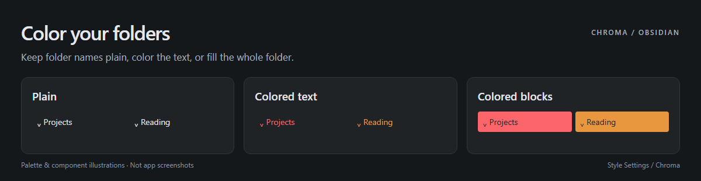

#### Active line highlight

**Disable active line highlight** defaults to **off**. The default highlight adds an accent wash to the cursor's line in Live Preview and Source mode.

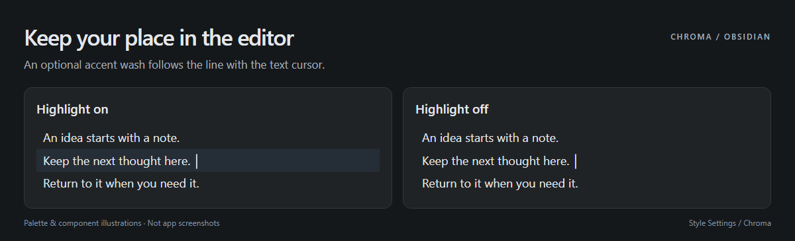

### Change the components

#### Callout appearance

**Callout appearance** defaults to **Filled**. Choose Filled, Outlined, Accent line, Tinted with accent line, Tinted, or Solid. Each preserves the callout type's color and folding behavior.

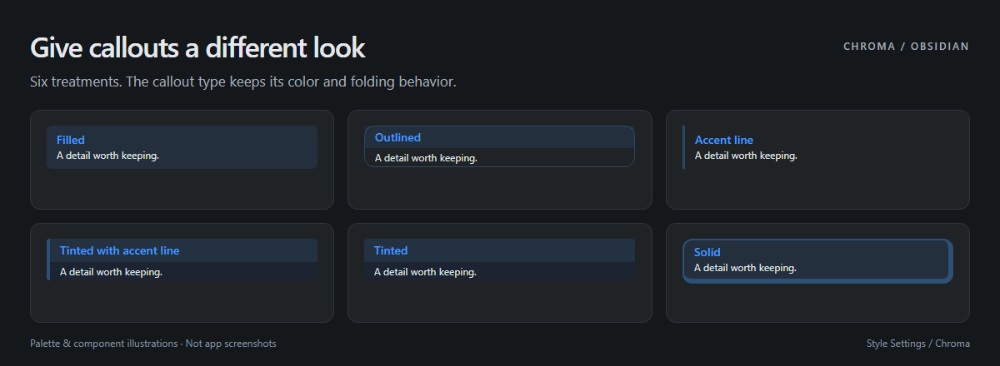

#### Heading colors

**Heading colors** defaults to **Plain**. **Accent** uses the link color for all headings. **Rainbow** assigns a different palette color to each level. The setting also affects the inline title.

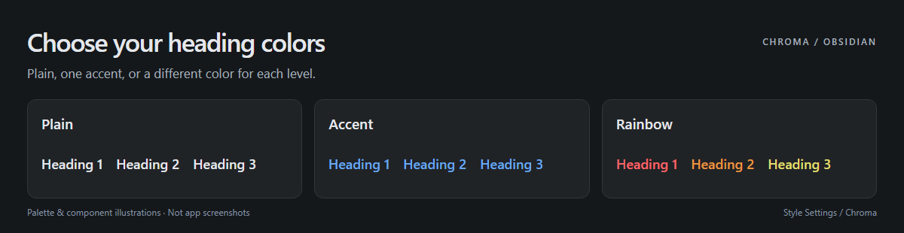

#### Alternate checkboxes

**Disable alternate checkboxes** defaults to **off**. Alternate task markers have custom icons and colors. Unknown markers use a plain checkmark. Turn the option on to restore Obsidian's standard checkboxes.

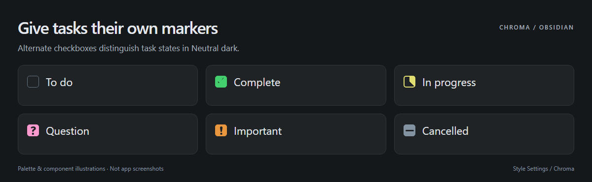

#### Links and emphasis

**Colorful links and emphasis** defaults to **on** in Style Settings. Internal links have soft pill backgrounds. Bold uses red, italic uses cyan, and bold italic uses purple from the active palette.

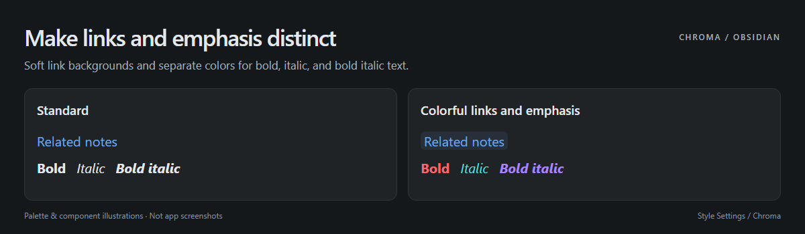

#### Table style

**Disable table style** defaults to **off**. Markdown tables and Bases tables have filled headers and striped rows. Bases groups have tinted headings, and Bases lists and Dataview lists have striped rows. Turn the option on to restore standard styling.

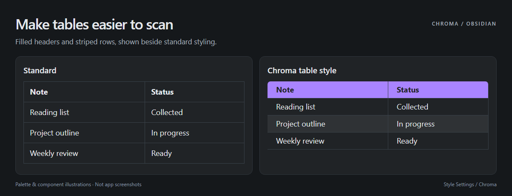

### Try a few combinations

- **A quiet workspace:** Neutral, Default panels, Plain folders, Plain headings, and Filled callouts.
- **More separation:** Harbor, Cards panels, Colored text folders, and Outlined callouts.
- **A warmer page:** Parchment, Raised editor panels, Accent headings, and Tinted with accent line callouts.

Alternate checkbox markers give tasks distinct appearances:

```markdown
- [ ] To do
- [x] Complete
- [/] In progress
- [?] Question
- [!] Important
- [-] Cancelled
```

Chroma changes task appearance. It does not add task scheduling or task management commands.

### Use Chroma without Style Settings

Chroma uses Neutral with the default panel layout, plain folders, plain headings, and filled callouts. The active line highlight, alternate checkboxes, and table styles remain active.

Colorful links and emphasis require the class that Style Settings adds. That feature is absent without the plugin, even though its setting defaults to on when the plugin is enabled.

## Feedback

[Report a bug or suggest a change](https://github.com/EdenEast/obsidian-chroma/issues). For a visual issue, include your Obsidian version, color scheme, appearance settings, and a screenshot with private content removed.

## Credits

Chroma is by EdenEast. Alternate checkbox icons are adapted from [Border by Akifyss](https://github.com/Akifyss/obsidian-border). The MIT notice for that code remains in [`theme.css`](theme.css).

The additional palettes draw from [Dracula](https://draculatheme.com/contribute), [Tokyo Night](https://github.com/folke/tokyonight.nvim), [Gruvbox](https://github.com/morhetz/gruvbox), [Horizon](https://github.com/jolaleye/horizon-theme-vscode), [Sonokai](https://github.com/sainnhe/sonokai), [Nordic](https://github.com/AlexvZyl/nordic.nvim), [Bearded Theme](https://github.com/BeardedBear/bearded-theme), [Nightfox](https://github.com/EdenEast/nightfox.nvim), [COSMIC's Mocha Dark](https://github.com/pop-os/cosmic-initial-setup), [Panda Syntax](https://github.com/linyanna/panda-syntax-obsidian), and [Everforest](https://github.com/sainnhe/everforest). Their source references are recorded in `theme.css`.
